

  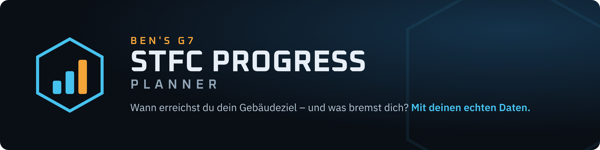

  
  
  
  

**Ben's G7 STFC Progress Planner** zeigt dir für *Star Trek Fleet Command*, **wann du ein Ziel erreichst** – ein Gebäude wie Operations 76 oder ein G7-Schiff wie die Praefortis auf Tier 9 – und **welches Material dich am meisten bremst**. Er rechnet nicht mit Schätzwerten, sondern mit deinen echten Daten aus [Spock's Club](https://next.spocks.club): deinem Ressourcenstand aus regelmäßigen Exporten und den Kosten deines Upgrade-Plans.

Der Planner ist **eine einzige HTML-Datei**. Kein Server, keine Anmeldung, kein Internet nötig – alles, was du einliest, bleibt in deinem Browser auf deinem PC.

  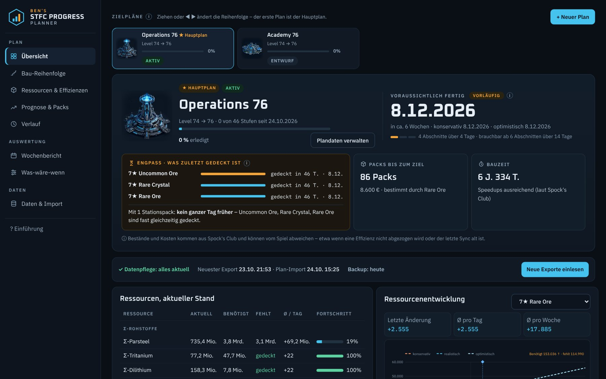

## Neu in Version 3.1

- **Ziel erreicht:** Gebaut? Unter „Plandaten verwalten“ schließt du den Plan ab – im Wochenbericht steht dann „Ziel erreicht“.
- **Schiffswerft-Plan statt „Startet nach“:** Nur noch ein Schiff kann auf einen Schiffswerft-Plan folgen. Gebäudeketten sind weg, weil sie gemeinsame Vorstufen doppelt zählten.

## Neu in Version 3.0

  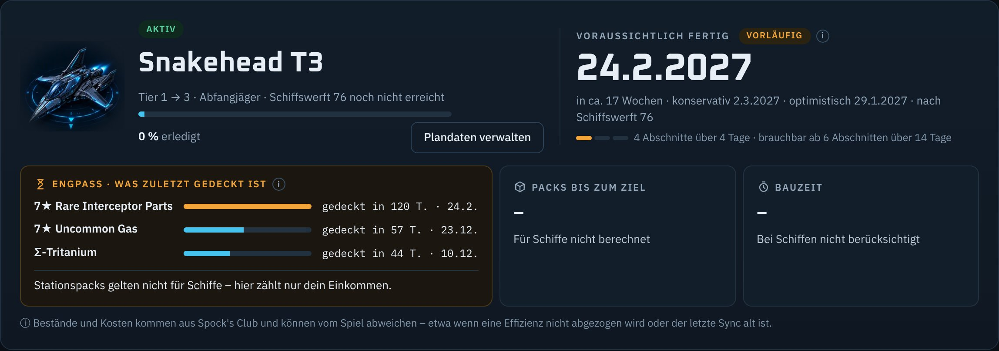

- **Schiffe planen:** Neben Gebäuden plant der Planner jetzt G7-Schiffe – Tier-Aufstieg oder Neubau. Zur Wahl stehen zehn G7-Schiffe mit ihrer Schiffswerft-Voraussetzung oder ein anderes Schiff mit frei gewählter Klasse (Kampfschiff, Abfangjäger, Forschungsschiff, Miner).
- **Schiffsteile zählen mit:** Common, Uncommon und Rare Parts der Klasse kommen aus dem JSON-Export und laufen durch Prognose, Engpass und Zieltermin wie jedes andere Material.
- **Voraussetzung auf einen Blick:** Der Planner prüft beim Anlegen, ob deine Schiffswerft laut Export hoch genug ist.
- **Startet nach** (ab 3.1 „Schiffswerft-Plan“): erst Schiffswerft 76, dann die Snakehead. Was die Schiffswerft kostet, ist vorgemerkt; das Schiff rechnet mit dem Rest.
- **Schiffsteile nachtragen:** Liest du ältere Exporte noch einmal ein, ergänzt der Planner ihre Schiffsteile, ohne Snapshots doppelt anzulegen – so gibt es sofort eine Prognose.
- **Einfacher Import:** Für Schiffe reichen zwei Texte aus dem Upgrade-Planer (*Total resources* und *Item costs & efficiencies*).

Packs rechnet der Planner für Schiffe bewusst nicht – Schiffs-Packs sind je Schiffsart anders aufgebaut als der Stationspack. Deine Daten aus früheren Versionen übernimmt 3.0 automatisch. Alle Änderungen im Detail: [CHANGELOG.md](CHANGELOG.md).

## Neu in Version 2.1

  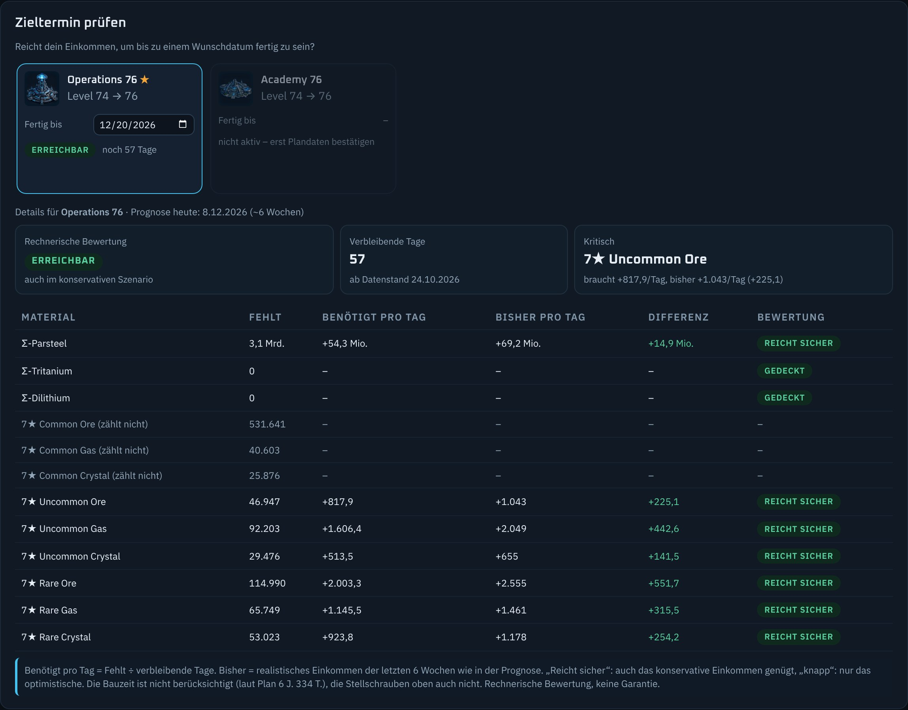

- **Zieltermin prüfen:** Unter Was-wäre-wenn hat jeder Zielplan ein eigenes „Fertig bis“. Die Karte zeigt sofort, ob dein Einkommen reicht – sicher, realistisch, knapp oder nicht –, ein Klick zeigt je Material, wie viel du pro Tag bräuchtest.
- **Effizienzen: Wirkung und Verlauf:** was deine Effizienzen sparen (Kosten statt Grundkosten), welche seit dem letzten Import gestiegen sind und wie viele Tage dich das früher ans Ziel bringt.
- **Wochenbericht:** Einkommen im Vergleich zur Vorwoche, Effizienzänderungen und ein Ausblick auf die kommende Woche.
- **Abschnitte ab 20 Stunden:** Wer täglich etwa zur gleichen Zeit exportiert, verliert keine Tage mehr, wenn es einmal 23 Stunden sind.
- **Sicherer Import:** Ältere Exporte ändern den aktuellen Bestand nicht mehr, Dateien mit ungültigen Werten werden abgelehnt.
- **Lesbare Langzeit-Termine:** über ein Jahr als „ca. Mai 2032 (~5,5 Jahre)“, über 100 Jahre „nicht absehbar“.
- **Neuer Name:** Der Planner ist ganz auf die 7★-Materialien (G7) zugeschnitten und heißt jetzt *Ben's G7 STFC Progress Planner*.

## Neu in Version 2.0

  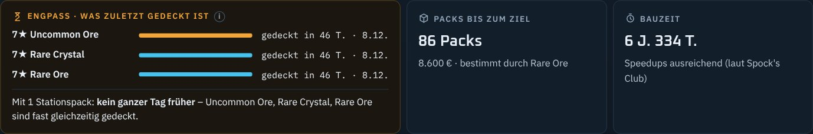

- **Engpass-Karte als Entscheidungshilfe:** die drei Materialien, die zuletzt gedeckt sind, und was ein Stationspack am Fertigstellungsdatum ändert – ohne Kaufempfehlung.
- **Prognose-Qualität:** vorläufig, brauchbar oder stabil, je nach Zahl der Abschnitte und abgedecktem Zeitraum. Längere Abschnitte zählen mehr als kurze.
- **Update-Assistent:** „N Pläne brauchen ein Update“ führt nacheinander durch den Import aller veralteten Pläne.
- **Einrichtung und Erklärungen:** fünf Schritte, die der Planner selbst abhakt, und ⓘ-Erklärungen zu Engpass, Abschnitt, Snapshot & Co.
- **Bessere Zielerkennung:** Operations auf gleicher Stufe gilt als Voraussetzung, nicht als Ziel; dein Planname bleibt erhalten.
- **Weniger Handarbeit:** Erlaubt der Browser den Ordnerzugriff, sucht der Planner beim Öffnen selbst nach neuen Exporten.
- **Sicherer Speicher:** Speicherfehler werden gemeldet statt still zu scheitern, mit Belegungsanzeige und Warnung ab 70 %.
- **Feinschliff:** Symbole, Diagramm mit Werten beim Darüberfahren, dezente Übergänge.

---

## Was der Planner kann

| | |
|---|---|
| 🚀 **Schiffe** | Tier-Aufstieg oder Neubau von G7-Schiffen mit Schiffsteilen, Prognose, Engpass und Prüfung der Schiffswerft-Voraussetzung. |
| ⛓️ **Schiffswerft-Plan** | Ein Schiff rechnet nach dem nötigen Schiffswerft-Plan: Was die Schiffswerft kostet, wird zuerst vom Bestand abgezogen. |
| ✅ **Ziel erreicht** | Gebaute Ziele abschließen – sie erscheinen im Wochenbericht. |
| 🎯 **Fertigstellungsprognose** | Realistisch, konservativ und optimistisch – berechnet aus deinem tatsächlichen Einkommen pro Material, mit Anzeige, wie belastbar das Datum ist (vorläufig, brauchbar, stabil). |
| 🧱 **Engpass** | Die drei Materialien, die bei deinem Einkommen zuletzt gedeckt sind – und um wie viele Tage dich ein Stationspack früher ans Ziel bringt. |
| 📦 **Packs bis zum Ziel** | Wie viele Stationspacks nötig wären – inklusive Kosten und „Was wäre, wenn ich jede Woche einen kaufe?“ (für Gebäudepläne). |
| 🏗️ **Bau-Reihenfolge** | Alle Pflichtgebäude nach OPS-Stufen gegliedert, per Ziehen anpassbar, mit Fortschritt seit Planbeginn. |
| 🗂️ **Mehrere Zielpläne** | Beliebig viele Ziele parallel; erledigte Schritte setzen betroffene Pläne auf „Veraltet“, und ein Update-Assistent führt nacheinander durch sie. |
| 📅 **Wochenbericht** | Fortschritt, Fertigstellung und Einkommen im Vergleich zur Vorwoche, Effizienzänderungen, Ereignisse und ein Ausblick auf die kommende Woche. |
| 🔮 **Was-wäre-wenn** | Packs sofort oder pro Woche, anderer Packinhalt, einmalige Zuwächse – und ein Zieltermin je Plan: reicht dein Einkommen bis zum Wunschdatum? |
| ⚙️ **Effizienzen** | Was deine Effizienzen sparen und wie sich Änderungen auf den Termin auswirken. |
| 💾 **Backups** | Automatisch nach jedem Import in einen Ordner deiner Wahl, Wiederherstellen mit einem Klick; Anzeige der Speicherbelegung und Warnung, bevor der Browser-Speicher voll ist. |
| 🧭 **Einrichtung & Erklärungen** | Fünf Schritte bis zur ersten Prognose, die der Planner selbst abhakt, und kurze Erklärungen zu jedem Fachbegriff. |

## So funktioniert es

  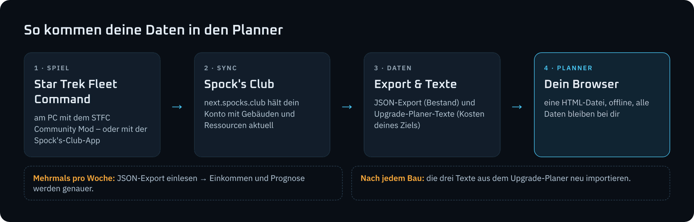

## Schnellstart

1. **Spock's Club einrichten** – Konto auf [next.spocks.club](https://next.spocks.club) anlegen und dein Spielkonto synchronisieren: am PC über den [STFC Community Mod](https://github.com/netniv/stfc-mod/releases) (Sync-Token unter *Syncing › Community Mod*) oder mit der Spock's-Club-App.
2. **Planner herunterladen** – [`Bens_G7_STFC_Progress_Planner_v3.1.0.html`](Bens_G7_STFC_Progress_Planner_v3.1.0.html) öffnen, rechts oben auf *Download raw file* klicken und die Datei an einem festen Ort speichern (oder die Datei aus dem neuesten [Release](https://github.com/Ben031982/STFC_Building_Planner/releases) nehmen). Dann per Doppelklick in **Chrome oder Edge** öffnen – eine kurze Einführung und die Einrichtung in der Übersicht führen dich durch die ersten Schritte.
3. **Account-Snapshot einlesen** – in Spock's Club unter *Syncing › Export Data* mindestens *Buildings* und *Resources* als **JSON** herunterladen und im Planner mit **„Neue Exporte einlesen“** übernehmen.
4. **Zielplan anlegen** – im Spock's-Upgrade-Planer genau **ein** Ziel anlegen, die drei Texte *Included upgrades*, *Total resources* und *Item costs & efficiencies* kopieren und im Planner unter **„Plandaten verwalten › Upgrade-Plan importieren“** einfügen. Prüfen, bestätigen – fertig. Für ein Schiff wählst du beim Anlegen *Schiff* und brauchst nur *Total resources* und *Item costs & efficiencies*.

> [!TIP]
> Exportiere **mehrmals pro Woche**. Für die erste Prognose braucht der Planner drei Abschnitte mit je mindestens 20 Stunden Abstand – also Exporte an vier verschiedenen Tagen.

📘 **Die ausführliche Anleitung mit Screenshots steht im [Userguide (PDF)](STFC_Planner_Userguide.pdf).**

## Einblicke

<table>
  <tr>
    <td width="50%">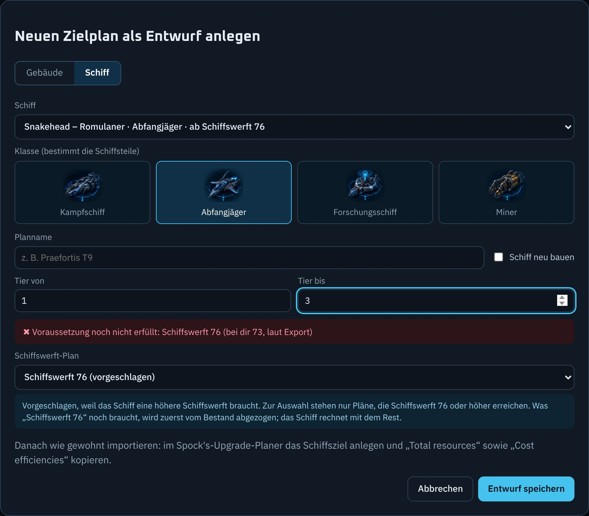 <b>Schiffsplan anlegen</b> – Schiff, Klasse, Tier und Voraussetzung</td>
    <td width="50%">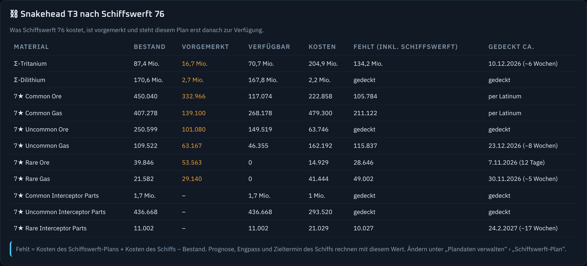 <b>Schiffswerft-Plan</b> – was die Schiffswerft braucht, ist vorgemerkt</td>
  </tr>
  <tr>
    <td width="50%">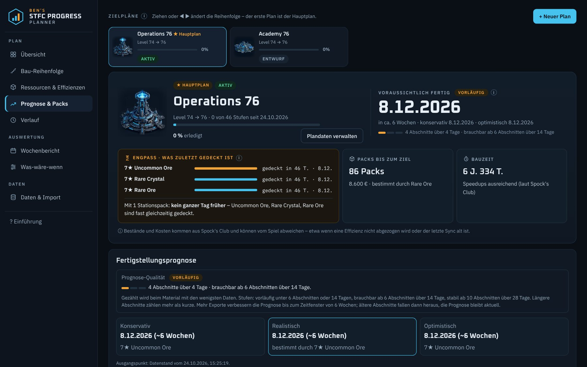 <b>Prognose &amp; Packs</b> – drei Szenarien und die Packs bis zum Ziel</td>
    <td width="50%">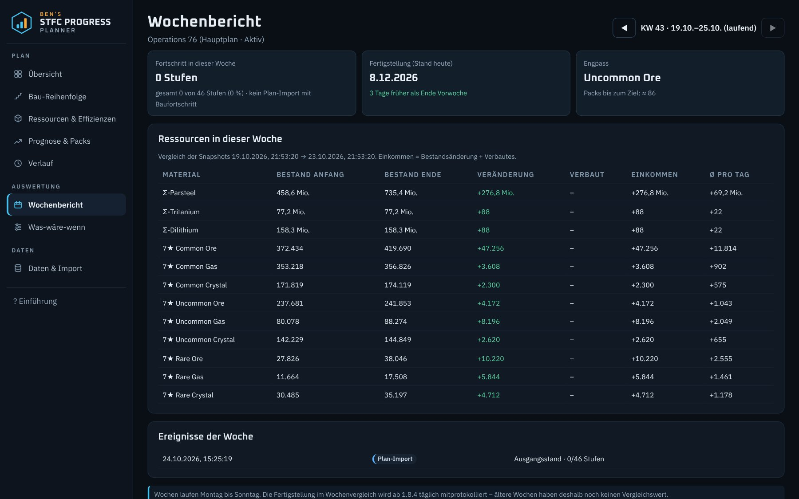 <b>Wochenbericht</b> – was sich in dieser Woche getan hat, mit Ausblick</td>
  </tr>
  <tr>
    <td width="50%">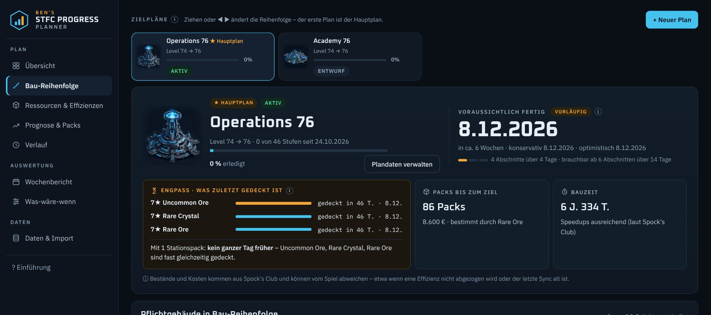 <b>Bau-Reihenfolge</b> – Pflichtgebäude nach OPS-Stufen</td>
    <td width="50%">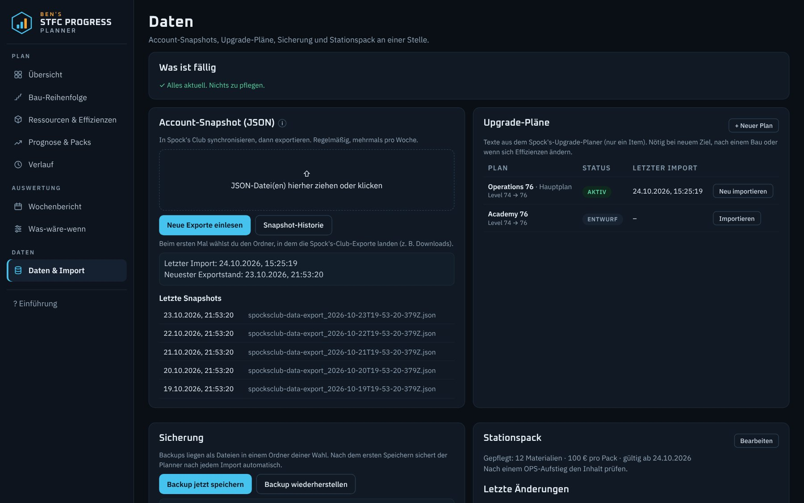 <b>Daten &amp; Import</b> – Snapshots, Upgrade-Pläne, Sicherung, Stationspack</td>
  </tr>
  <tr>
    <td width="50%">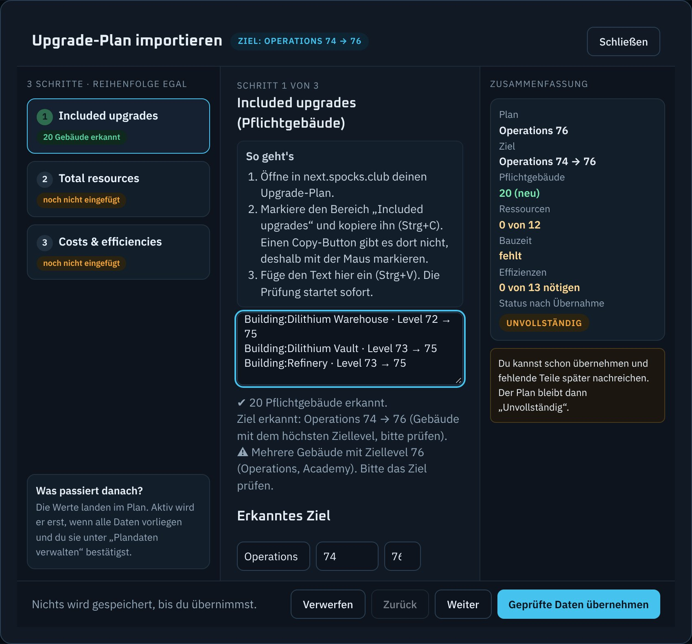 <b>Upgrade-Plan importieren</b> – geführt in drei Schritten</td>
    <td width="50%">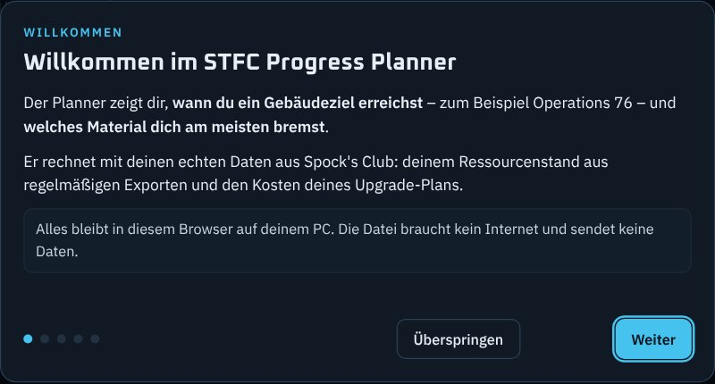 <b>Einführung</b> – erscheint beim ersten Öffnen</td>
  </tr>
  <tr>
    <td colspan="2">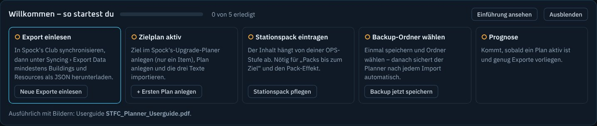 <b>Einrichtung</b> – fünf Schritte bis zur ersten Prognose, die der Planner selbst abhakt</td>
  </tr>
  <tr>
    <td colspan="2">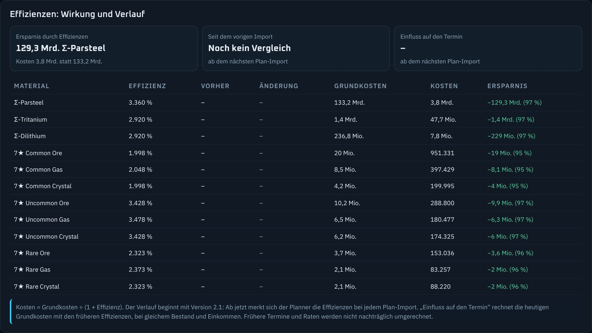 <b>Effizienzen</b> – Grundkosten, Kosten und Ersparnis; der Vergleich beginnt mit dem nächsten Plan-Import</td>
  </tr>
</table>

## Voraussetzungen

- Ein Konto bei **Spock's Club** (next.spocks.club) mit synchronisiertem Spielkonto
- **Chrome oder Edge** auf dem PC – nur dort funktionieren das Einlesen direkt aus dem Download-Ordner und automatische Backups. Andere Browser gehen auch, dann per Ziehen und Download.
- Sonst nichts: keine Installation, keine Anmeldung im Planner, kein Internet

## Deine Daten

- Alle Daten liegen im **Speicher deines Browsers** – nicht in der Datei und nicht im Internet.
- Eine neue Version der Datei übernimmt deine Daten automatisch, solange du denselben Browser verwendest.
- „Browserdaten löschen“ löscht auch die Planner-Daten. Richte deshalb gleich zu Beginn das **Backup** ein (*Daten & Import › Sicherung*).
- Der **Stationspack** startet leer: Trag einmal ein, was dein Pack enthält – der Inhalt hängt von deiner OPS-Stufe ab.

## Häufige Fragen

<b>„Alle Werte sind identisch zum letzten Snapshot“ – was heißt das?</b>

Du hast exportiert, bevor Spock's Club synchronisiert hat. Spiel starten (Community Mod) bzw. Sync in der App ausführen, auf der Syncing-Seite „Last sync“ prüfen und dann neu exportieren.

<b>Im Upgrade-Planer fehlen Materialien – ist das ein Problem?</b>

Nein. Spock's Club listet nur Materialien, die für dein Ziel noch gebraucht werden. Was im Text fehlt, wertet der Planner als bereits erfüllt.

<b>Warum nur ein Ziel im Upgrade-Planer?</b>

Bei mehreren Zielen gilt „Total resources“ für alle zusammen, und der Planner kann die Kosten nicht mehr einem Plan zuordnen. Für jedes Ziel legst du im Planner einen eigenen Plan an.

<b>Warum zeigt der Planner noch keine Prognose?</b>

Er braucht mindestens drei Abschnitte zwischen Exporten mit je 20 Stunden Abstand. Exportiere an mehreren Tagen – die Datenpflege in der Übersicht zeigt dir, wie viele noch fehlen. Danach zeigt die Plakette neben dem Datum, wie belastbar es ist: brauchbar ab 6 Abschnitten über 14 Tage, stabil ab 10 Abschnitten über 28 Tage.

<b>Warum zeigt ein Schiffsplan bei den Schiffsteilen „zu wenig Daten“?</b>

Exporte, die vor Version 3.0 eingelesen wurden, enthalten im Planner noch keine Schiffsteile. Lies die alten Export-Dateien noch einmal ein („Neue Exporte einlesen“ oder per Ziehen) – der Planner trägt die Schiffsteile nach.

<b>Die Bestände im Planner weichen vom Spiel ab – warum?</b>

Bestände und Kosten kommen aus Spock's Club. Sie können abweichen, etwa wenn Spock's Club eine Effizienz nicht abzieht oder der letzte Sync schon älter ist. Vor dem Export im Spiel synchronisieren und auf der Syncing-Seite „Last sync“ prüfen.

## Für Entwickler

Der Planner wird als eine Datei verteilt, aber im lesbaren Quellcode unter [`src/`](src) gepflegt. `python tools/build.py` setzt daraus die HTML-Datei zusammen (nur Python nötig), `python tests/run_tests.py` prüft sie automatisch im Browser (Playwright). Aufbau, Build und Tests beschreibt [`docs/ENTWICKLUNG.md`](docs/ENTWICKLUNG.md).

Neue Versionen entstehen per GitHub-Action **Release erstellen** (Actions › Run workflow): bauen, alle Tests, Release mit Planner-Datei und Userguide.

## Danke

- [**Spock's Club**](https://next.spocks.club) – für Synchronisierung, Export und Upgrade-Planer, auf denen dieser Planner aufbaut
- [**STFC Community Mod**](https://github.com/netniv/stfc-mod) von netniV und Mitwirkenden – für die automatische Synchronisierung am PC

---

Ein privates Fan-Projekt. Nicht verbunden mit Scopely, CBS Studios / Paramount oder Spock's Club. *Star Trek* und *Star Trek Fleet Command* sind Marken ihrer jeweiligen Inhaber. Die Gebäude- und Schiffsbilder im Planner sind eigene KI-generierte Grafiken.
